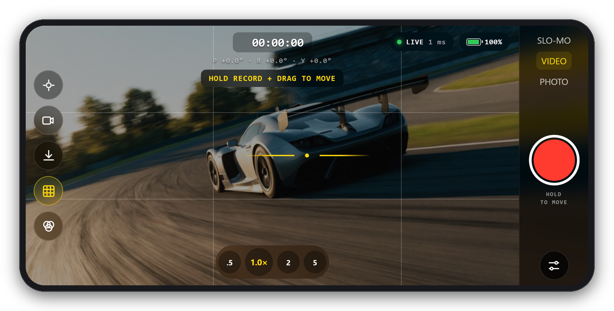
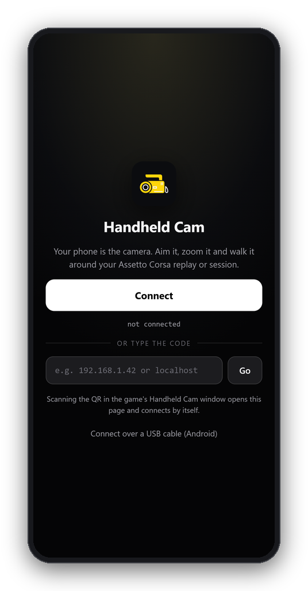
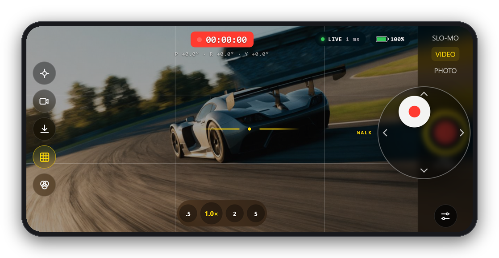
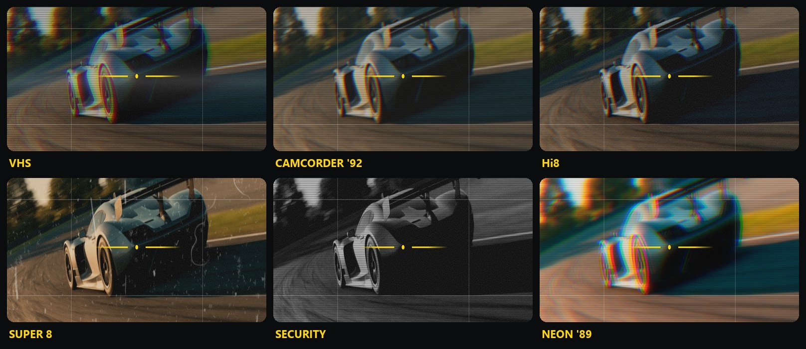
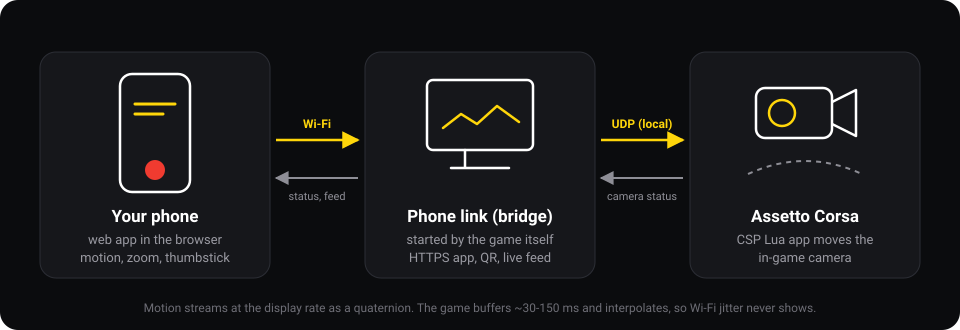

<h1 align="center">Handheld Cam</h1>

<p align="center"><b>Use your phone as a handheld camera in Assetto Corsa.</b></p>

<p align="center">
  
</p>

- Aim the in-game camera by moving your phone, through full 360° turns.
- Hold the record button and drag to walk the camera around the car.
- Zoom from 0.5× to 15×. 1.0× always matches the game's own framing.
- Record video or save photos to your phone with retro camera looks.

**Requires:** Assetto Corsa, [Content Manager](https://assettocorsa.club/content-manager.html),
[Custom Shaders Patch](https://acstuff.club/patch/), and a phone on the same Wi-Fi as the PC.

## Install

1. Download `HandheldCam-<version>.zip` from [Releases](https://github.com/hsassman/AC-handheld-cam/releases).
2. Drag it onto Content Manager.
3. In game, open **Handheld Cam** from the app bar.

Everything is included. The game starts the phone link by itself and stops it when AC closes.

From source instead: clone this repo and run `Install.bat` (needs [Node.js](https://nodejs.org) LTS).

## Connect



1. Open the **Connect** tab in the in-game window.
2. Scan the QR code with your phone's camera.
3. First time only: accept the certificate warning
   (Chrome: **Advanced → Proceed**, Safari: **Show Details → visit this website**).
4. Tap **Connect**. On iPhone, allow motion access.

Tip: add the page to your home screen to run it full screen.

Android over USB: run `bridge\usb-android.bat` from this repo, then open
`https://localhost:8787` on the phone.

<br clear="right">

## Controls

<p align="center">
  
</p>

| Control | What it does |
|---|---|
| Record button (tap) | Take over the in-game camera / hand it back |
| Record button (hold and drag) | Walk the camera. Choose Walk or Fly in Settings |
| VIDEO / SLO-MO / PHOTO | SLO-MO adds smoothing. PHOTO saves a screenshot on the PC and holds the frame |
| .5 / 1× / 2 / 5 | Jump zoom. Drag across them for the zoom wheel |
| Recenter | Current pose becomes straight ahead; walked camera comes home |
| Feed | Shows the game picture on the phone |
| Download | Saves a photo to the phone |
| Grid / Looks | Framing grid, and the camera looks |

Settings cover sensitivity, smoothing, deadzone, walk speed, axis inversion,
AR movement (Android), haptics, sound and screen options.

## Looks, photos and video

<p align="center">
  
</p>

With the live feed on, recordings and photos match the viewfinder: same
framing, same look, same date stamp. Video saves as MP4 (WebM on some
Android browsers) through the share sheet, or to Downloads. If the share
sheet doesn't open, tap **VIDEO READY · SAVE**. Turn recording off in
Settings → **Save video to this phone**.

Phone recordings use the live feed (up to 30 fps). For full quality, record
on the PC (replays, OBS) and use the phone to operate the camera.

## In-game window

- **Connect:** QR code, connected phones, firewall and network fixes.
- **Camera:** start/stop, recenter, attitude dial, walk home.
- **Tuning:** camera mount (car, tripod or AC's camera), trim, smoothing, hotkeys.
- **Status:** connection details and the phone link log.

## Troubleshooting

| Problem | Fix |
|---|---|
| Two or more Handheld Cam icons | Old copies are installed. Connect tab → **Move old copies out**, then restart AC |
| "The phone link would not start" | Update to 0.4.2 or newer (fixes `MODULE_NOT_FOUND`). Otherwise see Status → Phone link log |
| Phone can't connect | Connect tab → **Phone can't connect?** → **Allow through Windows Firewall**. Phone must be on Wi-Fi |
| Wrong address in the QR | Same section: pick the address on your home network |
| Phone shows **NO GAME** | Open the Handheld Cam window in game |
| Feed stutters the game | Turn the feed off while driving |

## How it works

<p align="center">
  
</p>

- `phone-app/`: web app. Reads orientation as quaternions and streams it at
  the display rate. `look.js` renders the looks with WebGL and records video.
- `bridge/`: Node.js phone link. Serves the app over HTTPS, relays packets
  over local UDP, provides the QR code and the live feed.
- `lua-app/HandheldCam/`: CSP app. Starts the phone link, buffers and
  interpolates the motion, and drives the camera.

## What's new

**0.4.2**
- Fixed the phone link not starting in game: CSP's argument quoting broke the
  path to the phone link (the real cause of `MODULE_NOT_FOUND`).
- The game now reconnects to the phone link after CSP reloads the app.
- The phone link's output also goes to CSP's log, for troubleshooting.

**0.4.1**
- Recording keeps working in AR mode; photos and videos waiting to be saved are queued, never replaced.

**0.4.0**
- One-step install: drag the zip into Content Manager; the game starts the phone link.
- REC records video to the phone, and photos and videos keep the look and framing.
- Smooth through full 360° turns.
- Detects duplicate installs, one-click firewall fix, network address picker.

## Development

```
Install.bat                   install from a checkout (needs Node.js)
Start Handheld Cam.bat        run the phone link in a console window
tools/build-release.ps1       build the Content Manager zip into dist/
tools/csp-harness/run.js      run the in-game app outside AC against a mock CSP
```

## License

MIT
