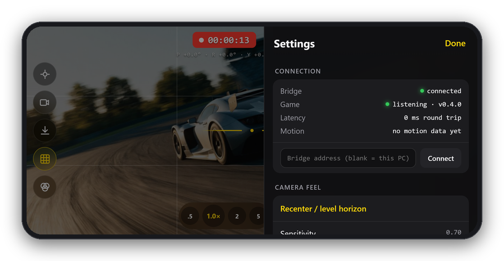
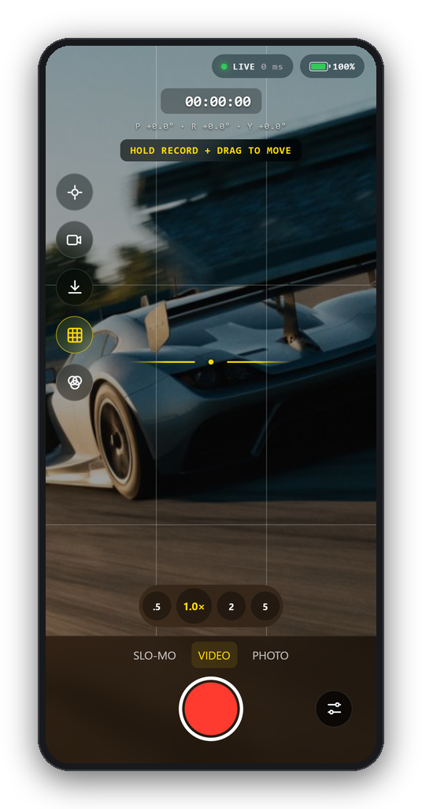
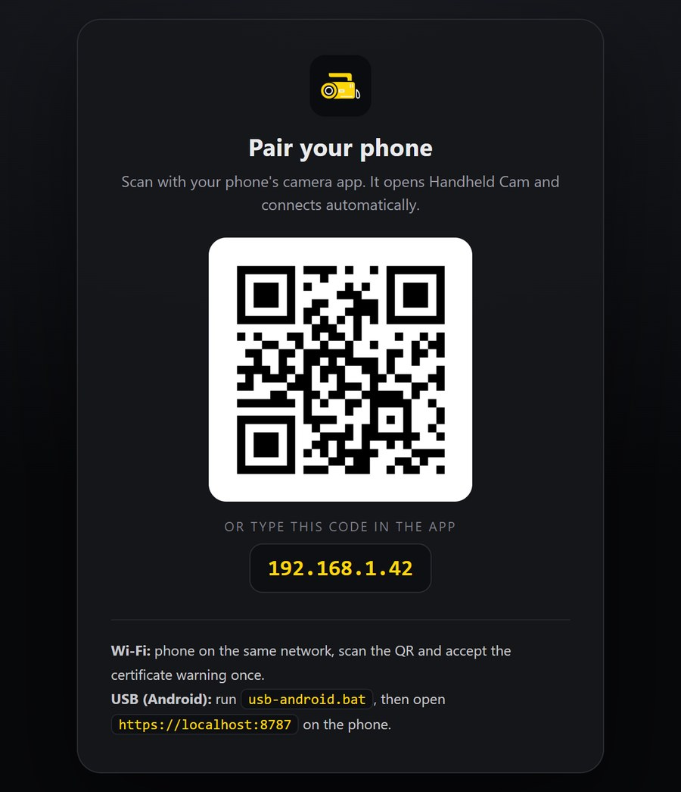

<h1 align="center">Handheld Cam</h1>

<p align="center">
  <b>Your phone becomes a handheld camera for Assetto Corsa.</b><br>
  Point it to aim, drag the zoom wheel, hold the record button to walk around the car,<br>
  and save the shot to your phone with a period camcorder look.
</p>

<p align="center">
  
</p>

<p align="center">
  <a href="#install">Install</a> ·
  <a href="#connect-your-phone">Connect</a> ·
  <a href="#using-the-phone-app">Phone app</a> ·
  <a href="#looks-photos-and-video">Looks and video</a> ·
  <a href="#in-game-window">In-game window</a> ·
  <a href="#troubleshooting">Troubleshooting</a> ·
  <a href="#how-it-works">How it works</a>
</p>

---

## What it does

- **Real handheld motion.** The phone's orientation drives the in-game camera
  through the full range: turn 90°, 180° or right round in a full circle,
  with no gimbal flips. Sensitivity, smoothing and a deadzone for hand
  tremor are adjustable.
- **Walk the camera around.** Hold the record button and drag it like a
  thumbstick to walk or fly the camera, on any phone, iPhone included. On
  Android, AR mode tracks you physically stepping around instead.
- **A real lens.** 0.5× to 15× zoom with a lens-ring wheel. 1.0× is always
  exactly the game's own framing, and the readout shows the true 35 mm
  equivalent focal length.
- **Looks that you can keep.** VHS, Camcorder '92, Hi8, Broadcast '95,
  Super 8, Security and Neon '89. With the live feed on, recordings and
  photos saved to your phone carry the look and the framing you see.
- **One-step setup.** Drag one zip into Content Manager, open the app in
  game, scan the QR code. The game starts and stops everything else by
  itself.

Needs Assetto Corsa with [Content Manager](https://assettocorsa.club/content-manager.html)
and [Custom Shaders Patch](https://acstuff.club/patch/), and a phone on the same
Wi-Fi as the PC (any recent iPhone or Android phone).

## Install

**The easy way (nothing else to install):**

1. Download `HandheldCam-<version>.zip` from the
   [Releases page](https://github.com/hsassman/AC-handheld-cam/releases).
2. Drag the zip onto Content Manager and confirm the install.
3. Start a session and open **Handheld Cam** from the app bar on the right
   of the screen.

The zip includes everything: the in-game app, the phone link (bridge), the
phone web app and a private copy of Node.js that only Handheld Cam uses.
The game starts the phone link when you open the app window and closes it
when Assetto Corsa closes.

**From a git checkout** (for development): double-click `Install.bat`. It
finds Assetto Corsa through Steam (or drop your `assettocorsa` folder on it),
installs the app with the phone link inside it, and moves old copies of the
app out of `apps\lua`. This route needs [Node.js](https://nodejs.org) LTS.
Run it again any time to update.

To build the release zip yourself:
`powershell -ExecutionPolicy Bypass -File tools\build-release.ps1`
(the zip lands in `dist\`).

> **Only keep one copy.** Every folder in `apps\lua` is a separate app to
> CSP, backups included. Two copies show as two icons and fight over the
> phone's data. The in-game window warns you and offers to move extras out.

## Connect your phone


1. In game, open **Handheld Cam** and go to the **Connect** tab. It shows a
   QR code and a short code (your PC's address).
2. Scan the QR code with the phone's camera app.
3. The first time only, the browser warns about the certificate. Tap
   **Advanced** then **Proceed** (Chrome) or **Show Details** then **visit
   this website** (Safari). The phone link makes its own certificate, and
   phones only allow motion sensors on secure pages.
4. Tap **Connect**. On iPhone, allow motion access when asked.

No QR scanner? Type the code from the Connect tab into the start screen.

**USB (Android, no Wi-Fi needed):** with USB debugging enabled and
[platform-tools](https://developer.android.com/tools/releases/platform-tools)
installed, run `bridge\usb-android.bat` from this repository, then open
`https://localhost:8787` on the phone. There's no certificate warning over
USB.

**Add it to your home screen** (Share → Add to Home Screen on iPhone,
Chrome's install prompt on Android) to run it full screen. On iPhone that's
the only way to hide the address bar.

The chip at the top right shows where things stand:

| Chip | Meaning |
|---|---|
| **LIVE** 12 ms | The game is receiving you (round-trip time) |
| **NO GAME** | The phone reached the PC but the in-game window isn't open yet |
| **STANDBY** | Another phone has control. Tap **Take over** |
| **RECONNECTING** | Wi-Fi dropped; it retries by itself |

<br clear="right">

## Using the phone app

<p align="center">
  
</p>

- **Record button.** Tap to take over the in-game camera, tap again to hand
  it back. With the live feed on it also records a video to your phone (see
  below).
- **Hold to move.** Press and hold the record button, or drag off it, and it
  becomes a thumbstick. Up walks forward along the lens, sideways strafes,
  and how far you push sets the speed. **Walk** stays level; **Fly** goes
  where you aim. The chip at the top left shows how far you've moved; tap
  it to bring the camera home.
- **Modes.** VIDEO, SLO-MO (extra smoothing for slow cinematic drift) and
  PHOTO. In PHOTO the shutter flashes, the game saves a full-quality
  screenshot to `Documents\Assetto Corsa\screens`, and the framing holds
  until you tap again.
- **Zoom.** Tap **.5 / 1× / 2 / 5** to jump, or drag across them to open the
  zoom wheel (0.5× to 15×, with a detent at 1.0×; double-tap to reset).
- **Left rail.** Recenter (makes the current pose "straight ahead" and
  brings a walked camera home), live feed, save photo, grid, looks.
- **Works in landscape and portrait.**

<p align="center">
  
  
</p>

**Settings** (the slider icon): connection status, sensitivity, smoothing,
deadzone, walk speed and walk/fly, per-axis invert, AR 6DoF movement
(Android Chrome), save video to this phone, grid, level indicator, haptics,
shutter sound, keep screen awake and fullscreen. Everything is remembered on
the phone.

**AR movement (Android).** Settings → **Start AR 6DoF movement** uses the
phone's own tracking (WebXR), so stepping or leaning moves the camera.
iPhone browsers don't offer WebXR, so iPhones use the thumbstick.

## Looks, photos and video

<p align="center">
  
</p>

Pick a look with the looks button (three circles). With the **live feed**
on, the phone renders the game picture through the look on its GPU, so:

- **What you see is what you save.** Photos (download button) and videos
  have the same framing as the viewfinder, the same look, and the camcorder
  date stamp where the look has one.
- **Video.** In VIDEO or SLO-MO, the record button also records the live
  feed to an MP4 (WebM on browsers that can't write MP4). When you stop,
  the phone's share sheet opens: choose **Save Video** (iPhone) or it goes
  to Downloads (Android). If the sheet can't open straight away, a
  **VIDEO READY · SAVE** chip appears; tap it. Turn this off with
  **Save video to this phone** in Settings.
- **Photo.** The download button saves a still the same way.

The live feed is the PC screen captured by the phone link, at up to 30 fps
by default. Its resolution and frame rate set the quality of phone
recordings. For full-quality video, record on the PC (AC replays, OBS,
ShadowPlay) while you operate the camera from the phone.

Looks change the phone's picture only, never what the game renders.

## In-game window

The window is resizable and has four tabs. Settings are saved between
sessions.

- **Connect.** The pairing QR and code, how many phones are connected, and
  **Phone can't connect?**: one-click Windows Firewall permission, and a
  picker for the right network address if your PC has several (VPNs,
  virtual machines).
- **Camera.** Start/stop, recenter, re-attach, a live attitude dial with
  the lens readout, and **Walk home** once you've moved the camera.
- **Tuning.** Camera mount (stick to the car, tripod, or follow AC's own
  camera), mount trim, extra stabilisation, zoom inertia, what the phone is
  allowed to do, per-axis invert, and **hotkeys** for start/stop and
  recenter (keyboard or wheel buttons).
- **Status.** Phone link, socket, packets, buffer, camera state, zoom maths,
  and the phone link's log when something goes wrong.

Stopping the camera in game wins over the phone; the phone's record button
takes it back on its next press.

### Camera mount

Taking over the camera stops AC from moving it, so the app rebuilds the
position every frame from where the camera was when you engaged:

- **Stick to the car** (default): rigidly attached, including suspension and
  body roll. Walking moves you around the car and still rides with it.
- **Lock to a fixed spot**: stays put like a tripod while the car drives off.
- **Follow AC's own camera**: keeps AC's own camera position.

It re-attaches by itself when you change view (F1/F3/F6) or focus another
car, and on **Re-attach here** or recenter.

## Troubleshooting

| Problem | Fix |
|---|---|
| Two or three Handheld Cam icons in the app bar | Old copies are installed. The Connect tab offers **Move old copies out**; restart AC afterwards. |
| "Starting the phone link…" never finishes | Status tab → Phone link log. Reinstall from the release zip. From a git checkout, install Node.js and run `Install.bat` again. |
| Phone can't connect over Wi-Fi | Connect tab → **Phone can't connect?** → **Allow through Windows Firewall** (one admin prompt; it can hide behind the game, so Alt+Tab). Check the phone is on Wi-Fi, not mobile data. |
| Phone says certificate error / nothing loads | Open `https://<code>:8787/health` on the phone, accept the warning, then tap Connect again. |
| Wrong address in the QR | Connect tab → **Phone can't connect?** → pick the address on your home network. |
| Phone says **NO GAME** | Open the Handheld Cam window in game. CSP only starts the app once its window has been opened. |
| Live feed stutters the game | Turn the feed off while driving, or set `HC_FEED_FPS=15` before starting `Start Handheld Cam.bat`. |
| "Port 8787 is already in use" | Another copy of the phone link is already running (for example `Start Handheld Cam.bat`). The game uses that one. |

## How it works

<p align="center">
  
</p>

- **`phone-app/`**: the web app on your phone. It reads orientation as a
  quaternion (the sensor's own quaternion on Android Chrome, orientation
  events on iPhone), never raw Euler angles, which flip at 90°. Sensitivity
  is applied to an unwrapped rotation, so it stays smooth through any
  number of full turns. It streams at the display rate together with zoom,
  mode and the thumbstick. `look.js` renders the feed through the looks
  with WebGL and records it with the browser's MediaRecorder.
- **`bridge/`**: a small Node.js server (the "phone link"). It serves the
  phone app over HTTPS with its own certificate, relays packets to the game
  over local UDP and status back to the phone, lets one phone control the
  camera at a time, serves the pairing QR to the in-game window, and
  captures the monitor the game is on for the live feed.
- **`lua-app/HandheldCam/`**: the CSP Lua app. It starts the phone link,
  listens on UDP 9191, timestamps samples on the phone's clock, plays them
  back slightly behind real time (30 to 150 ms, adapting to how jittery
  the Wi-Fi is) and interpolates between them, so bursty packets become
  continuous motion. It applies the result to the camera with real lens
  maths for zoom.

<p align="center">
  <br>
  <sub>The same QR is also at <code>https://&lt;PC-IP&gt;:8787/pair</code> in a browser on the PC.</sub>
</p>

### Certificates

The phone link makes its own self-signed certificate for `localhost`,
`127.0.0.1` and your PC's network address, and remakes it if the address
changes (the phone asks you to accept it once more). It lives in the
`bridge\certs` folder of the installed app, or in
`%LOCALAPPDATA%\HandheldCam\certs` if that folder isn't writable.

## Development

```
lua-app/HandheldCam/   in-game CSP app (HandheldCam.lua, manifest.ini, icon.png)
bridge/                phone link: server.js (Node.js)
phone-app/             phone web app: index.html, app.js, motion.js, look.js
tools/                 build-release.ps1 (Content Manager zip)
docs/images/           README images
assets/                design prompts and generated artwork
```

`Start Handheld Cam.bat` runs the phone link in its own console window,
which is handy while developing; the game then uses that copy.

## License

MIT
